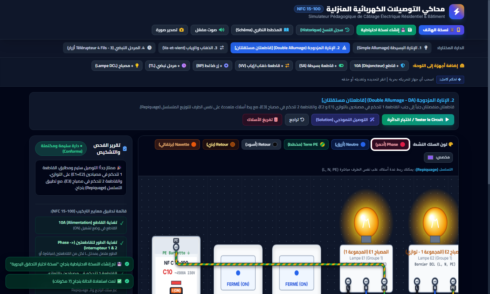

# ⚡ محاكي التوصيلات الكهربائية المنزلية (كهرباء البناء) | NFC 15-100
## Simulateur Avancé et Interactif de Câblage Électrique Résidentiel

محاكي تفاعلي وبيداغوجي متطور لتركيبات كهرباء البناء بالمتصفح وفق المعايير القياسية الفرنسية والدولية (**NFC 15-100**)، مصمم لمساعدة الطلاب والمهندسين والفنيين على فهم واختبار الدارات الكهربائية المنزلية بحرية تامة وتطبيق معايير السلامة والتسلسل (Repiquage).



---

### 🚀 الميزات الرئيسية (Fonctionnalités Principales):

1. **إدارة حرة وكاملة للمكونات (Full Component Management)**:
   - إضافة وحذف ونقل أي جهاز على اللوحة بالسحب والإفلات (Drag & Drop).
   - قواطع 10A، قواطع تفاضلية، قواطعات بسيطة (SA)، قواطعات ذهاب وإياب (VV)، أزرار ضاغطة (BP)، مرحلات نبضية (Télérupteurs)، ومصابيح DCL.
   - إعادة توجيه ذكية للمسارات المتعامدة (Orthogonal Wire Routing) لحظياً أثناء التحريك.
   - تسمية وتكرار وحذف أي جهاز مع تنظيف آلي لجميع أسلاكه.

2. **تخصيص كامل للألوان والتوصيل (Wiring Customization)**:
   - ترميز ألوان قياسي وفق مواصفات NFC 15-100 (طور: أحمر، محايد: أزرق، تأريض: أصفر/أخضر، راجع: أسود/بني، تبادل: برتقالي).
   - منتقي ألوان مخصص وإمكانية تغيير لون السلك بنقرة واحدة.
   - براغي توصيل واقعية تدعم ربط عدة أسلاك على نفس المأخذ للتوزيع المتسلسل (**Repiquage**).

3. **نظام النسخ الاحتياطي التلقائي وسجل الاستعادة (Auto-Backup & History)**:
   - حفظ تلقائي للدارة في المتصفح كل 45 ثانية وعند كل تعديل.
   - تصدير واستيراد ملفات الدارات بصيغة JSON.
   - استعادة فورية لأي لقطة سابقة.

4. **مخططات ودارات معتمدة بالكامل**:
   - الإنارة البسيطة (Simple Allumage - SA).
   - الإنارة المزدوجة (Double Allumage - DA) بقاطعتين منفصلتين (القاطعة 1 تتحكم في مصباحين بالتوازي، والقاطعة 2 في مصباح منفرداً).
   - الذهاب والإياب (Va-et-vient - VV) بالمعايير الفرنسية والألمانية والأمريكية.
   - المرحل النبضي 4 أسلاك بـ 3 أزرار ضاغطة (Télérupteur 4 Fils).

5. **محرك المحاكاة والفحص الآلي (Circuit Continuity Engine)**:
   - فحص مستمر للاتصال وتوهج واقعي للمصابيح.
   - كشف مباشر للدارات القصيرة (Court-circuit) مع وميض وفصل آلي للقواطع.
   - تقارير تدقيق وإرشادات باللغة العربية مع مصطلحات تقنية فرنسية دقيقة.

---

### 🌐 التشغيل المباشر عبر المتصفح (Live Demo):
يمكنك تجربة ومشاركة المحاكي فوراً عبر الرابط العام المباشر:
👉 **[https://gamer5012.github.io/electrical-wiring-simulator/](https://gamer5012.github.io/electrical-wiring-simulator/)**

### 💻 التشغيل المحلي (Local Run):
```bash
# تشغيل خادم محلي باستخدام بايثون
python -m http.server 8080
# ثم افتح المتصفح على: http://localhost:8080
```
